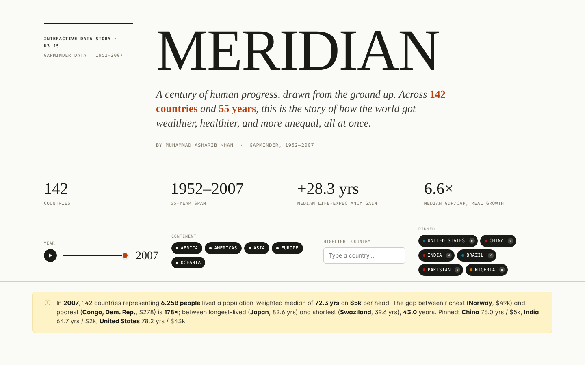
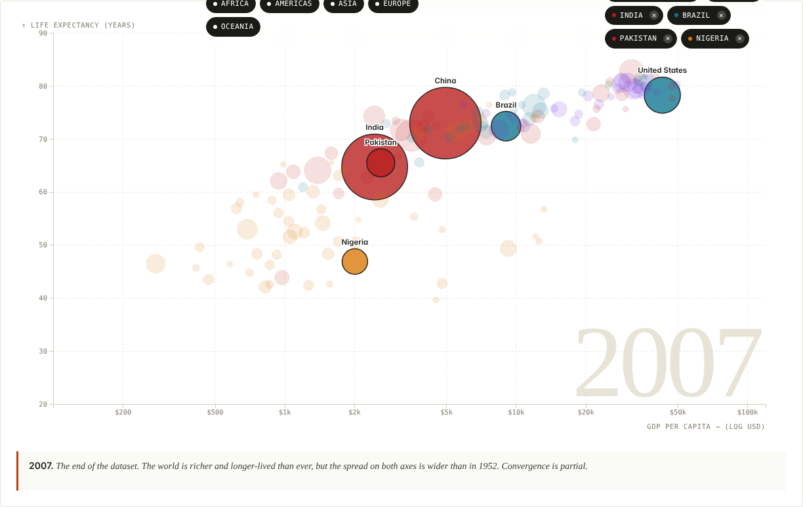
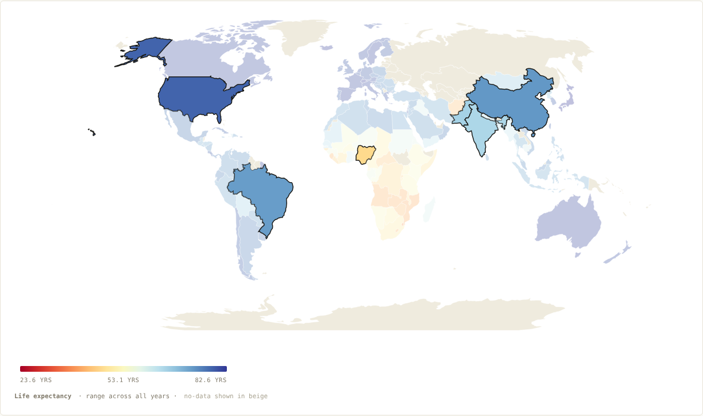

# MERIDIAN

**A Century of Human Progress**, an interactive D3.js data journalism piece built on the Gapminder dataset.



## Author

Muhammad Asharib Khan

## What is in this project

Six interactive, linked visualizations of country-level life expectancy, GDP per capita, and population for 142 countries from 1952 to 2007:

1. **The Rosling Race**, animated bubble chart with play, pause, year stamp, and historical annotations.
2. **The Choropleth**, world map with switchable metric (life expectancy, GDP per capita, population).
3. **The Trajectory Plot**, connected scatter showing 55-year paths through indicator space.
4. **The Beeswarm**, force-directed distribution grouped by continent with population-weighted medians.
5. **The Bump Chart**, ranking trajectories of the 20 most populous countries.
6. **The Trellis**, sortable small-multiples grid with three sparklines per country.

All six are linked. Click any country anywhere to pin it everywhere. Drag the year slider to scrub time. Hit play to auto-advance.

## Screenshots

| The Rosling Race | The Choropleth |
|---|---|
|  |  |

## How to run

### Easiest: just open it

Unzip the folder and **double-click `index.html`**. It works straight from disk in Chrome, Edge, Firefox and Safari, with no server, no internet and no install. D3 and TopoJSON are bundled in `js/vendor/`, and the data is embedded in `data/data.js`. Only the Google Fonts need internet; without it the page falls back to system fonts.

### Local server (optional)

```bash
cd meridian
python3 -m http.server 8000      # Windows: python -m http.server 8000
```

Then open http://localhost:8000. You can also double-click `start-server.bat` (Windows) or run `./start-server.sh` (macOS/Linux).

### GitHub Pages / any static host

`.nojekyll` is included. Push the repo, enable Pages on the `main` branch root, and it's live. Netlify Drop, Vercel and Cloudflare Pages work the same way. Nothing needs building at deploy time.

## Editing the code

`index.html` loads the **built** files (`js/meridian.bundle.js` + `data/data.js`) so it can run from disk. The source of truth is still the ES modules in `js/`. After editing anything in `js/` or `data/*.json`, rebuild:

```bash
python3 build.py
```

It uses only the Python standard library (no Node or npm). If you'd rather work on the modules directly without rebuilding, serve the folder over HTTP and open `index.dev.html`.

## Project structure

```
meridian/
├── index.html                  Entry point (works from disk or a server)
├── index.dev.html              Same page, loads ES modules directly (needs a server)
├── build.py                    Rebuilds js/meridian.bundle.js + data/data.js
├── start-server.bat / .sh      Optional one-click local server
├── README.md                   This file
├── DESIGN.md                   Full design rationale and engineering notes
├── .nojekyll                   Tells GitHub Pages to skip Jekyll
├── .gitignore
├── .gitattributes              Marks generated/vendored files for GitHub
├── docs/                       README screenshots
├── preprocess.py               Data pipeline, fetches Gapminder + TopoJSON, emits JSON
├── css/
│   └── style.css               Editorial design system, all visual tokens
├── js/
│   ├── util.js                 Shared state, dispatch, formatters, color palette
│   ├── main.js                 Bootstrap, loads data, mounts hero + controls + charts
│   ├── meridian.bundle.js      Generated by build.py (do not edit)
│   ├── vendor/                 Local D3 v7.9 + TopoJSON reader (no CDN needed)
│   └── charts/
│       ├── race.js             Animated bubble race
│       ├── map.js              World choropleth
│       ├── trajectory.js       Connected scatter
│       ├── beeswarm.js         Distribution swarm
│       ├── bump.js             Ranking bumps
│       └── trellis.js          Small multiples
└── data/
    ├── gapminder.json          Nested by country
    ├── by_year.json            Indexed by year
    ├── countries.json          Country metadata and headline metrics
    └── world_topo.json         World TopoJSON
```

## Regenerating the data

The four JSON files in `data/` are committed so the project runs out of the box, but they are reproducible:

```bash
pip install pandas requests
python3 preprocess.py
```

This will overwrite the four JSON files (and `data/data.js`) with fresh fetches from the canonical Gapminder mirror and the world-atlas CDN.

## Tech stack

- D3.js v7
- TopoJSON Client v3
- Vanilla JavaScript ES modules
- No framework, no npm, no bundler (optional `build.py` uses only the Python standard library)

## Browser support

Tested on current Chrome, Firefox, and Safari. Requires support for ES modules and CSS custom properties, which means roughly any browser from 2019 onward.

## Dataset attribution

- Gapminder dataset, cleaned by Jenny Bryan, https://github.com/jennybc/gapminder
- world-atlas TopoJSON by Mike Bostock, https://github.com/topojson/world-atlas

See `DESIGN.md` for the full design rationale, EDA findings, chart-by-chart justification, and engineering notes.
